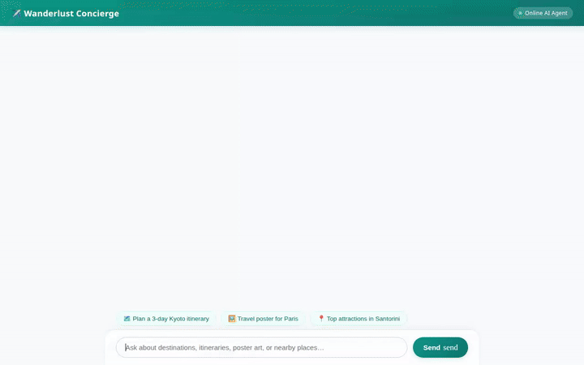

# Wanderlust Concierge ✈️



**Wanderlust Concierge** is an intelligent, multi-modal travel assistant built with the **Agent Development Kit (ADK)** and powered by **Gemini 2.5 Flash** on **Vertex AI Agent Engine**. It helps travelers plan itineraries, discover top attractions, fetch destination summaries, store custom destination records, and generate custom AI travel posters and illustrations.

---

## 🌟 Capabilities & Features

Wanderlust Concierge implements a multi-tool architecture integrated with Google Cloud services:

* **Structured Itinerary & Budget Calculations**: Uses **Agent Engine Sandboxed Python Code Execution** (`AgentEngineSandboxCodeExecutor`) to calculate daily costs, schedule timelines, and structure multi-day travel plans safely.
* **Cross-Session Memory Bank**: Powered by `PreloadMemoryTool` and an automated memory callback (`generate_memories_callback`) to remember past search queries, location preferences, and user travel interests across chat sessions.
* **Firestore Destination Database**: Integrates directly with **Google Cloud Firestore** (`google.cloud.firestore`) to query (`search_destinations`), inspect (`get_destination_details`), and save custom travel records (`save_destination`) to a `destinations` collection.
* **AI Travel Illustrations & Poster Art**: Leverages **Imagen** models via Vertex AI to generate destination art and travel posters (`generate_destination_illustration`, `generate_travel_poster`).
* **Cloud Storage Media Hosting**: Automatically uploads generated travel posters to a **Google Cloud Storage** (`google.cloud.storage`) bucket and returns public HTTPS image URLs for visual rendering.
* **Google Maps & Places API**: Performs geocoding (`geocode_address`) and discovers nearby points of interest and attractions (`find_nearby_places`).
* **Wikipedia Summaries**: Fetches cultural highlights and historical overviews using the **Wikipedia REST API** (`fetch_destination_wiki_summary`).
* **A2UI Rich Visual Rendering**: Converts agent outputs into structured, interactive UI components (Cards, Columns, Rows, Text, Images, Icons) via `a2ui_callback` and A2UI schema catalog.

---

## 🏗️ Repository Architecture

```
wanderlust-concierge/
├── app/
│   ├── agent.py               # Root ADK agent, tools, memory callback, and A2UI schema
│   ├── a2ui_utils.py          # A2UI response formatting & payload conversion
│   └── __init__.py
├── frontend/
│   ├── main.py                # FastAPI proxy server (A2A protocol interface)
│   ├── static/
│   │   └── index.html         # Single-page chat interface with A2UI catalog rendering
│   └── requirements.txt
├── agents-cli-manifest.yaml   # Manifest for agents-cli deployment
├── deployment_metadata.json   # Region & Agent Engine resource deployment metadata
├── pyproject.toml             # Python dependencies (google-adk, google-genai, etc.)
└── demo.gif                   # Demo screen recording
```

---

## 🛠️ Local Setup & Development

### Prerequisites

* Python 3.11+
* Google Cloud CLI (`gcloud`) authenticated with a project
* Active Vertex AI, Firestore, and Google Cloud Storage APIs

### Environment Configuration

Create a `.env` file in the project root:

```bash
GOOGLE_GENAI_USE_VERTEXAI=true
GOOGLE_CLOUD_PROJECT=your-gcp-project-id
GOOGLE_CLOUD_LOCATION=us-east1
```

### Installation

1. **Install dependencies**:
   ```bash
   pip install -e .
   ```

2. **Run the Agent Engine backend locally**:
   ```bash
   adk run app
   ```

3. **Start the Frontend Web Application**:
   Navigate to the `frontend/` directory, set the resource name environment variable, and start the FastAPI proxy server:
   ```bash
   cd frontend
   export AGENT_ENGINE_RESOURCE_NAME="projects/YOUR_PROJECT_NUMBER/locations/us-east1/reasoningEngines/YOUR_ENGINE_ID"
   export AGENT_DIRECTORY="app"
   python main.py
   ```

---

## 🚀 Cloud Deployment

### Deploying the Agent Engine Backend

Deploy the ADK agent to Vertex AI Agent Engine using `agents-cli`:

```bash
agents-cli deploy
```

### Deploying the Frontend to Cloud Run

Build and deploy the FastAPI proxy and web UI to Google Cloud Run:

```bash
cd frontend
gcloud run deploy wanderlust-concierge-frontend \
  --source . \
  --region us-east1 \
  --allow-unauthenticated \
  --set-env-vars AGENT_ENGINE_RESOURCE_NAME="projects/YOUR_PROJECT_NUMBER/locations/us-east1/reasoningEngines/YOUR_ENGINE_ID",AGENT_DIRECTORY="app"
```

Grant the Cloud Run service account access to invoke the Reasoning Engine:

```bash
gcloud projects add-iam-policy-binding YOUR_PROJECT_ID \
  --member="serviceAccount:YOUR_CLOUD_RUN_SA@appspot.gserviceaccount.com" \
  --role="roles/aiplatform.user"
```

---

## 🧪 Testing

Run test suites locally using `pytest`:

```bash
pytest
```
